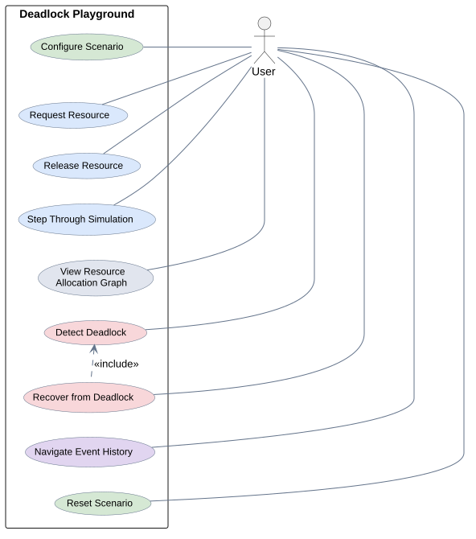
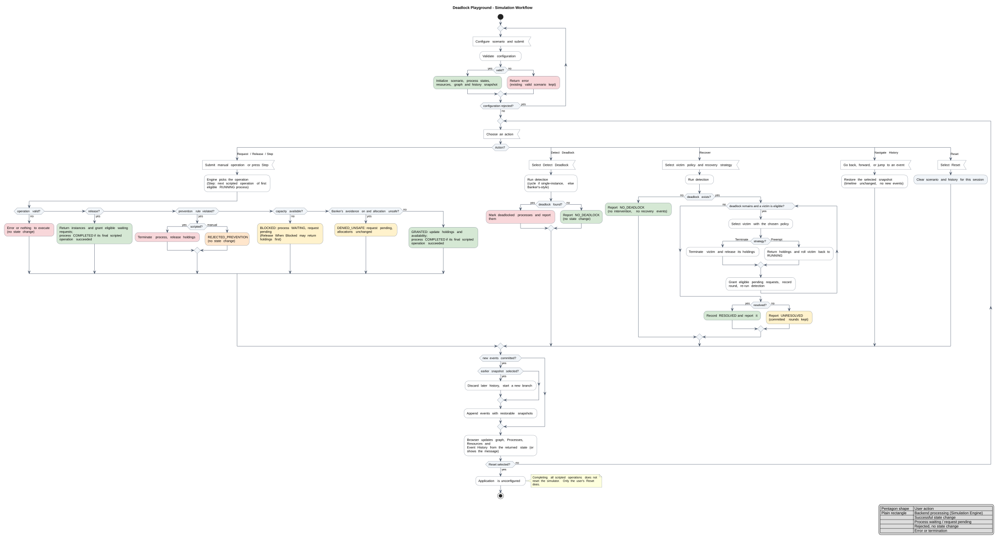
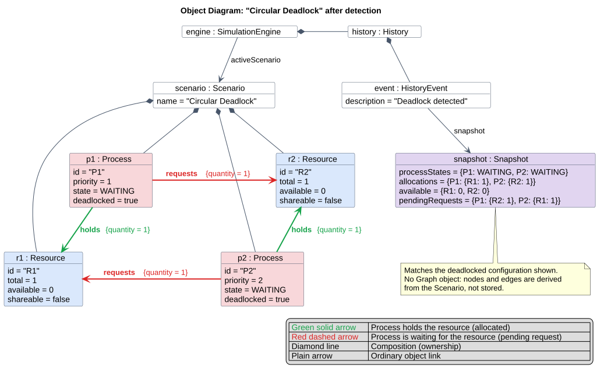

## Object-Oriented Analysis

The starting point for Deadlock Playground was an Operating Systems problem: several processes compete for a finite collection of resources, and certain request sequences can leave them waiting on one another forever. The goal was to make those sequences visible. The design problem was deciding how to turn processes, resources, requests, policies and changing allocations into a set of collaborating objects.

### Finding the system boundary

The simulator receives a scenario, applies operations and returns the resulting state. The browser is where a user enters commands and explores the Resource Allocation Graph, but the browser does not decide whether an allocation is safe or which processes are deadlocked. Those decisions belong to the Java model and simulation engine.

The system models resources and processes; it does not manage real ones. There is no CPU scheduling, no interaction with an operating system's resource manager and no account or database layer. Keeping that boundary explicit helped avoid classes that would have made sense in an OS kernel but added nothing to this simulator.

### Actors and use cases

The primary actor is a user, usually someone exploring deadlocks or demonstrating them. The HTTP client is a boundary between the actor and the backend, not a second human actor. The application exposes these operations:

| Use case | What the user does | Main responsibility in the backend |
|---|---|---|
| Configure scenario | Define processes, priorities, resource instances, shareability and optional request/release scripts. | Validate and install a `Scenario`; start a fresh history. |
| Request resource | Ask for one or more instances on behalf of a running process. | Apply prevention rules, capacity constraints and optional safety checking. |
| Release resource | Return held instances. | Update holdings and availability, then reconsider blocked requests. |
| View resource allocation graph | Inspect processes, resources, allocation edges and pending requests. | Derive graph data from the current scenario; return it with the authoritative state. |
| Step simulation | Execute the next eligible scripted operation. | Advance the correct process cursor and record its effects. |
| Detect deadlock | Check whether the current state contains deadlocked processes. | Choose the appropriate detector and report the result. |
| Recover | Select a victim policy and terminate or preempt a victim. | Detect, select an eligible victim, intervene, wake waiters and repeat as needed. |
| Reset | Discard the active trial. | Clear the scenario and event history for the current session. |
| Navigate history | Select an earlier or later recorded event. | Restore its snapshot and keep the displayed state synchronized. |

  

Recovery calls detection internally, even if the user never pressed Detect. A resource request runs Banker's safety check only when avoidance is enabled. Those are dependencies between behaviors, not reasons to invent separate actors.

### Following a request through the system

A request is a useful first use case because it touches state, policies and visualization.

**Precondition:** A scenario exists and the selected process is `RUNNING`.

The user supplies a process ID, resource ID and instance count. The HTTP layer validates the JSON shape and resolves the browser session. The engine then checks the request against the configured prevention rules and declared maximum claim when avoidance is active. If the resource has enough exclusive capacity, an avoidance-mode request is tentatively checked for safety before it can be granted.

A successful grant changes holdings and available counts. An unavailable request becomes pending and the process waits. A request that would create an unsafe state is also deferred, but its outcome is distinguished from an ordinary capacity block. A prevention rule can reject the request altogether. The response carries the resulting state, so the frontend doesn't have to reconstruct resource accounting from individual events.

A manual request does not consume an operation from the process's scripted sequence. This mattered in the model: an outstanding request needs to remember where it came from, because a delayed scripted grant must advance its script while a delayed manual grant must not.

### Following recovery through the system

**Precondition:** A scenario is loaded. The user chooses a victim-selection policy and either termination or preemption.

Recovery starts with detection. If there is no deadlock, nothing is changed. Otherwise the engine identifies processes whose exclusive holdings contribute to a blocking cycle and asks the selected `VictimPolicy` to choose among them. It applies the chosen `RecoveryStrategy`, rechecks pending requests, runs detection again and continues only while another useful intervention is possible.

Termination removes the selected process from further execution and returns its resources. Preemption releases the selected process's holdings and returns it to the start of its scripted work. Each committed round is recorded. An attempt that cannot make any intervention preserves the original state; an attempt that made some progress keeps those rounds even if the final result is unresolved.

This use case showed the need to separate *finding* a deadlock, *choosing* a victim and *changing* the state. They are related decisions, but they do not have the same reason to change.

### Finding candidate classes from nouns

The initial descriptions contained nouns like process, resource, request, graph, priority, allocation, deadlock and victim. Treating every noun as a class would have produced a large model with several objects carrying no behavior. Noun analysis helped separate domain entities from values, relationships and interface concepts.

| Candidate | Decision | Reason |
|---|---|---|
| `Scenario` | Class | Owns a configured trial: processes, resource types, scripts and prevention settings. |
| `Process` | Class | Has persistent state, priority, holdings, a pending request and execution progress. |
| `Resource` | Class | Tracks capacity, availability and shareability. |
| `Operation` | Value object | Describes a scripted request or release with a resource and count. |
| `ProcessState` | Enum | A fixed set of states, not an entity with independent behavior. |
| Allocation | Association/data | A quantity held by a process for a resource, not a separate identity-bearing object. |
| Pending request | State within `Process` | Stores a blocked demand and whether it originated from scripted or manual work. |
| Resource instance | Attribute/count | Instances have no independent lifecycle in this model. |
| `Graph` | Derived view | Builds nodes and edges from current scenario data. |
| Deadlock | Result | Represented by a `DetectionResult` and deadlock flags, not a long-lived `Deadlock` entity. |
| Victim | Role of a process | A process becomes a recovery candidate; it is not a different kind of process. |
| Priority | Attribute | Belongs to a process and is read by one victim policy. |
| `SafetyChecker` | Service/calculation | Evaluates a proposed allocation against declared maximum claims. |
| `DetectionStrategy` | Interface | Allows the detector to change with resource instance counts. |
| `VictimPolicy` | Interface | Encapsulates different rules for selecting an eligible victim. |
| `RecoveryStrategy` | Interface | Encapsulates termination and preemption. |
| `History`, `HistoryEvent`, `Snapshot` | Classes | Separate event ordering from restorable state. |
| Button, form, panel | View concerns | They belong to the frontend, not the domain model. |

The same technique rules out attractive but unnecessary abstractions. A separate `Deadlock` object would have duplicated information already present in a detection result. A `Victim` subclass would have confused a temporary role with an object's identity. Modeling each unit of a resource as an object would have made simple integer accounting harder.

### Refining the model through behavior

The first pass only tells us which objects might exist. Use cases and object interactions tell us which responsibilities they need.

A scenario cannot be just a bag of IDs: it must keep process holdings consistent with resource availability. A process must distinguish its four lifecycle states and retain a pending demand when blocked. The engine needs a single place to coordinate request and release effects, scripted progress and history commits. Detection and victim-selection logic need common interfaces because the same use case can follow different paths depending on the scenario and selected policy.

A request also exposes the need for result types. `RequestResult` communicates whether a request was granted, blocked, denied as unsafe or rejected by prevention, without forcing the frontend to infer an outcome from side effects. `DetectionResult` and `SafetyResult` play a similar role for their calculations.

These choices lead into the [domain model](domain-model.md). The [object collaboration](object-collaboration.md) document shows how the same responsibilities are exercised at runtime.

  

### A concrete snapshot

Suppose `P1` holds the only instance of `R1` and waits for `R2`. `P2` holds `R2` and waits for `R1`. The analysis identifies two process objects, two resource objects, holding and waiting relationships, and a detector that evaluates the current state. It does not require a special `DeadlockedProcess` subtype. Both objects remain ordinary processes whose `deadlocked` flags can be set by detection.

With multiple instances, even a cycle in the graph might be resolvable. That is why the graph and the detector have distinct responsibilities: one describes current relationships; the other decides whether they constitute deadlock under the resource counts.

  

