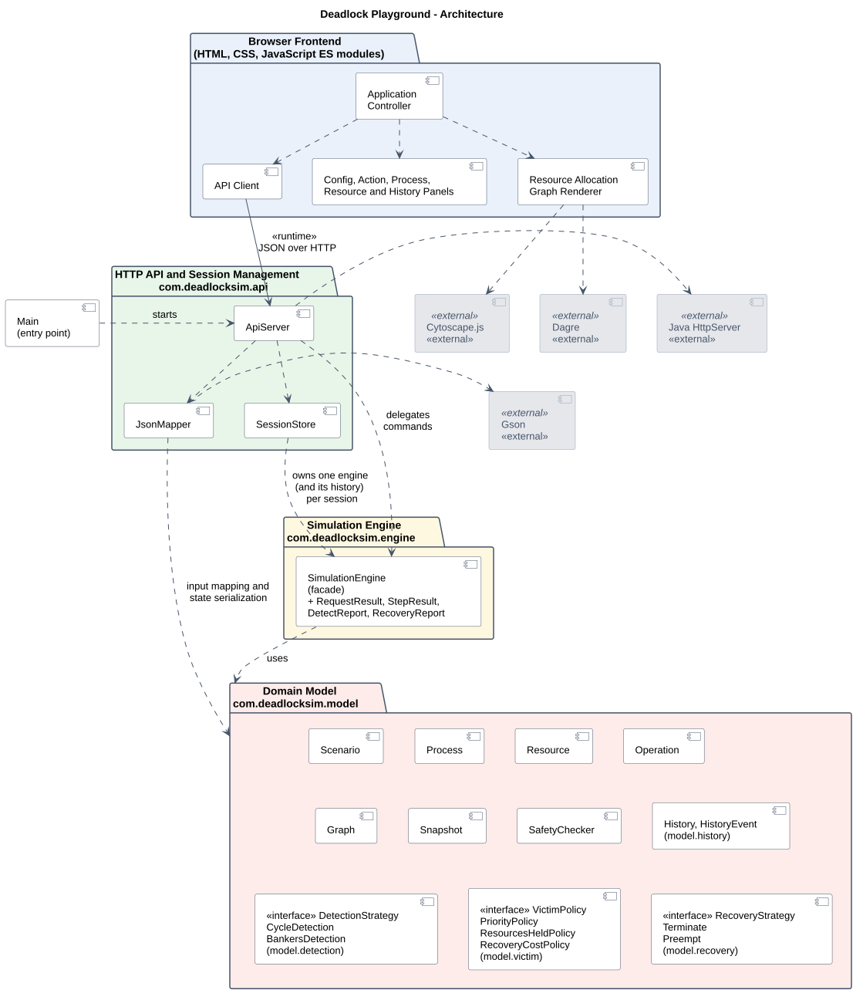

## Architecture

Deadlock Playground runs as a small Java web application with a browser-based interface. The browser submits commands and draws the resulting state. Java owns the rules: which resources are available, what a process is waiting for, whether a grant is safe, and what recovery changes. Keeping those roles separate means the graph cannot quietly disagree with the simulation.

### The main boundaries

The code is organized around four responsibilities:

| Area | Location | Responsibility |
|---|---|---|
| Browser presentation | `frontend/` | Forms, controls, process/resource panels, event history and graph rendering |
| HTTP and session boundary | `backend/.../api/` | Route commands, validate JSON and origin, resolve sessions, serialize results, serve frontend files |
| Simulation coordination | `backend/.../engine/` | Execute use cases and coordinate state changes, policies, detection, recovery and history |
| Domain model | `backend/.../model/` | Define processes, resources, operations, graphs, safety checks, policies and snapshots |

The frontend is built with HTML, CSS and vanilla JavaScript modules. It uses Cytoscape.js for the Resource Allocation Graph and Dagre for layout. Neither library decides whether a process is deadlocked. The API sends graph nodes and edges derived by Java, and the frontend renders them.

The architecture is **layered**, with a presentation layer, an HTTP adapter, a coordinating engine and a domain model. It can also be described loosely in MVC terms: the browser is the view, the HTTP handling performs controller-like work, and the engine and model hold simulation behavior. A strict MVC label would hide the fact that the backend has its own separate application-service boundary.

<p align="center">
  <a href="diagrams/architecture.svg">
    
  </a>
</p>

### Following one command through the layers

A browser command travels in one direction and the resulting state comes back:

1. The relevant frontend panel collects the user's input and sends JSON through the shared API client.
2. `ApiServer` checks the route, method, content type, origin and request shape. It resolves the browser session.
3. The session's `SimulationEngine` executes the command against its active `Scenario`.
4. The engine uses domain objects and algorithms, then records committed events and snapshots.
5. `JsonMapper` serializes the updated state. The frontend uses that authoritative response to redraw its panels and graph.

The request and recovery sequence diagrams are discussed in [Object collaboration](object-collaboration.md). Those diagrams are more useful for understanding specific method interactions than the component view alone.

### Why the domain does not depend on the browser

`Process` is still a process if the graph renderer changes. `Resource` still has available and allocated units if the UI panels are reorganized. The Java model does not need to know about Cytoscape node styles, DOM elements or HTTP status codes to decide whether a grant is possible.

`Graph` is a useful boundary object here. It derives process and resource nodes, request edges and allocation edges from the scenario. The serialized form uses separate internal namespaces for process nodes, resource nodes and edges; the original user-provided IDs remain labels. The frontend has no reason to maintain a parallel map of which resources a process holds.

The API returns the complete state after a successful mutation. That costs more JSON than a small event-only response, but it simplifies consistency: the process panel, resource panel and graph all redraw from the same result. Revision information also helps the browser reject or refresh stale views during navigation and overlapping requests.

### Sessions and object ownership

Each retained browser session has its own `SimulationEngine`, scenario and event history. `SessionStore` owns the temporary session records; `ApiServer` retains the store and resolves a session from its cookie. Commands for one session are serialized against that session's engine, so two requests cannot mutate its simulation at once.

A simplified illustration of the ownership boundary is:

```java
// Conceptual sketch; exact SessionStore APIs are intentionally omitted.
final class Session {
    private final SimulationEngine engine;

    Session(SimulationEngine engine) {
        this.engine = engine;
    }
}
```

The important part is the relationship: a session retains one engine, rather than the server exposing one global mutable simulation to every visitor. Multiple tabs sharing a cookie see the same trial. Different browser sessions do not share scenario state or history. The session data lives in memory, expires after inactivity and is lost if the server restarts. There is no database behind the simulator.

A session's engine has zero or one active `Scenario`, which can be replaced by a successful configuration command or cleared by Reset. The scenario contains the configured process and resource objects. `History` belongs to the engine, and its events reference snapshots of that scenario's runtime state. The domain relationships are covered in [Domain model](domain-model.md).

### Java packages and their dependency direction

The package structure follows the responsibilities rather than organizing every file by what the browser happens to display:

```text
com.deadlocksim
├── Main
├── api
│   ├── ApiServer, SessionStore
│   ├── ApiInput, JsonMapper
│   └── ErrorMapper, ErrorCode
├── engine
│   ├── SimulationEngine
│   └── RequestResult, StepResult, DetectReport, RecoveryReport, ...
└── model
    ├── Scenario, Process, Resource, Operation
    ├── Graph, SafetyChecker, Snapshot
    ├── history
    ├── detection
    ├── victim
    └── recovery
```

`api` depends on `engine` and `model` to translate requests into use-case calls and responses. `engine` depends on the model's entities and policies. The core model does not depend on frontend JavaScript or the HTTP server. The strategy families live under `model/detection`, `model/victim` and `model/recovery`, where their behavior can be tested independently of the transport layer.

The package layout is not perfectly pure Clean Architecture. For example, `SimulationEngine` chooses concrete detection and recovery implementations in some paths, while `ApiServer` constructs the requested victim policy. The engine uses interfaces at the decision points but is not completely insulated from every concrete type. That is an honest description of the current design, not a reason to invent a dependency-injection container.

### Packaging and runtime

Maven builds the Java 17 backend, runs its JUnit 5 tests and packages the browser assets into the executable JAR. Gson handles JSON, and the application uses the JDK's built-in HTTP server instead of a separate web framework. The frontend has no Node.js build step. Docker packages the application for deployment on Render.

This architecture keeps the deployment simple, with one server process and no external database. It also means that instance restarts, including free-hosting inactivity spin-downs, clear all active simulations. The session boundary is designed for temporary interactive trials, not durable user projects.

### Testing across the boundaries

The tests exercise different levels of the same architecture. Model tests check resource accounting, detection, victim policies, recovery and snapshots. Engine tests cover use-case behavior, delayed grants and history branching. API tests check request contracts, session isolation, graph consistency and HTTP behavior; browser regression checks exercise synchronization between state, history and rendering. Keeping these layers testable helps catch cases where each individual algorithm seems correct but the complete transition is not.

For why these particular boundaries were chosen, including what they cost, see [Design decisions](design-decisions.md).